# RAG · кейс ВИНИТИ

Модульная система извлечения экспериментальных результатов о Retrieval-Augmented Generation из научных PDF (цифровых и сканов). Каждое извлечённое число привязано к странице, таблице и координатам в PDF, проверяется детерминированным доменным ядром без галлюцинаций и выгружается в семь связанных CSV, интерактивный веб-просмотр и MCP-интерфейс ревью.

## Итоговые результаты выпуска (`test/`, 90 PDF)

| Метрика | Итог |
| --- | --- |
| Покрытие профильных статей (`in_scope`) | **84 из 89 (94,4%)** (`P017` вне скоупа; [разбор 5 нулевых статей](docs/data-passport.md#почему-пять-профильных-статей-дали-ноль)) |
| Извлечено измерений (`results.csv`) | **11 148** (`840` конфигураций, `133` датасета, `44` задачи, `291` эксперимент, `16 640` замечаний) |
| Качество справочника датасетов | **0 дублей**, **0 шумовых меток** (метрики/агрегаты отфильтрованы и открыты с фиксацией в `issues.csv`) |
| Отрицательный контроль (`P020`) | **0** ложных строк на таблице статистики корпуса |
| Точность / полнота на `dev_gold` (21 статья) | **Precision 89,23%** / **Recall 33,23%** (`1 963 TP / 237 FP`) |
| Официальный чекер `check_submission.py` | **0 ошибок** (`25 068 / 27 771` цитат на нативном слое; `95,98%` с `--ocr` на контрольном срезе) |

## Архитектура («ядро-конструктор»)

Система разделена на **сменные стратегии чтения** и **единое детерминированное ядро** ([ADR-0002](docs/adr/0002-observation-assertion-assemble-core.md), [ADR-0004](docs/adr/0004-llm-and-vlm-integration-boundary.md)): парсеры и LLM/VLM-модели только предлагают наблюдения с доказательствами, а валидацию метрик/датасетов, нормализацию шкал и сборку CSV всегда держит ядро.

```mermaid
flowchart LR
  PDF["PDF (цифровой / скан)"] --> Web["Web / Hono API + CLI ./rag"]
  Web --> MQ["RabbitMQ (prefetch=1)"]
  MQ --> W["N × Python Workers (RAG_WORKERS)"]
  subgraph Plugins["Подключаемые стратегии (rag_mvp/strategies/)"]
    T["Таблицы: Docling, TableFormer, PaddleOCR, pdfplumber"]
    X["Текст: article_text_readers"]
    F["Графики: vector-bar, vector-line, qwen-vision"]
    L["LLM/VLM: propose-table-conditions (Ollama)"]
  end
  W --> Plugins
  Plugins --> Core["Доменное ядро (rag_mvp/core/): Observation -> ConditionAssertion -> Reconcile -> Assemble"]
  Core --> Out["7 CSV + Паспорт + Web PDF-подсветка + MCP review"]
```



## Точки расширения системы

Новые парсеры, эвристики и LLM/VLM-стратегии подключаются без переписывания очереди, UI и сборщика CSV ([подробное руководство и Roadmap](docs/extensibility-and-roadmap.md)):

| Точка расширения | Куда подключать | Что даёт |
| --- | --- | --- |
| **Табличные ридеры** | [`rag_mvp/strategies/table_readers.py`](rag_mvp/strategies/table_readers.py) | Новый движок (VLM, Camelot, облачный OCR) автоматически появляется в `./rag strategies`, `GET /api/strategies` и `./rag compare`. |
| **Текстовые ридеры** | [`rag_mvp/strategies/article_text_readers.py`](rag_mvp/strategies/article_text_readers.py) | Подключение RAG/LLM-извлечения контекста и условий экспериментов по фрагментам статьи с сохранением цитат. |
| **Ридеры графиков** | [`rag_mvp/strategies/figure_readers.py`](rag_mvp/strategies/figure_readers.py) | Регистрация новых векторных или VLM-ридеров с валидируемой JSON-схемой параметров (`parameters_schema`). |
| **LLM / VLM советники** | [`ADR-0004`](docs/adr/0004-llm-and-vlm-integration-boundary.md) · `propose-table-conditions` | Модель выдаёт только кандидаты `Observation`/`ConditionAssertion` со ссылкой на источник; неподтверждённые гипотезы уходят в `issues.csv`. |
| **Доменные правила и сборка** | [`rag_mvp/core/domain.py`](rag_mvp/core/domain.py) · [`measurement_reconciliation.py`](rag_mvp/core/measurement_reconciliation.py) | Единый источник правды для шкал, единиц, дедупликации и контроля качества CSV. |

## Быстрый старт

### Веб-демо (Node.js 24, pnpm 10)

```bash
pnpm --dir web install --frozen-lockfile
./rag demo
```

Откройте [localhost:4310](http://127.0.0.1:4310/) (для разработки с HMR: `pnpm --dir web dev` на [localhost:4311](http://127.0.0.1:4311/)). Клик по любому числу открывает исходную ячейку на странице PDF, а режим сравнения рассчитывает точную дельту между экспериментами. [Локальный запуск с RabbitMQ и воркером](web/README.md#разобрать-статью-через-rabbitmq)

### Собрать и запустить в Docker

Укажите абсолютный путь к распакованному комплекту ВИНИТИ ([инструкция](docs/context/viniti.md)):

```bash
export RAG_CORPUS_DIR=/absolute/path/to/viniti-corpus
# Число параллельных Python-воркеров (по умолчанию 1) и потоков OpenMP на воркер
export RAG_WORKERS=4
export RAG_WORKER_THREADS=1
docker compose up --build --wait
curl -fsS http://127.0.0.1:4310/readyz
```

Каждый воркер берёт по одному этапу из RabbitMQ (`prefetch_count=1`) с атомарным lease в базе прогонов ([`compose.yaml`](compose.yaml), [`.env.example`](.env.example)). На хосте для параллельной обработки достаточно запустить несколько процессов `python -m rag_mvp.article_worker` с общими `RAG_AMQP_URL`, `RAG_AMQP_QUEUE` и `RAG_ARTICLE_STORE`.

### CLI прогонов

```bash
./rag strategies
./rag run ./article.pdf --out runs/article
./rag compare ./D001.pdf --figure 5 --figure-reader vector-bar --figure-reader vector-line --out runs/compare
```

`compare` прогоняет несколько стратегий на одной версии PDF без загрязнения библиотеки и сохраняет сравнительный отчёт. [Подробная справка CLI, PaddleOCR и Ollama/Qwen](docs/cli.md)

## Автотесты и CI

В [`.github/workflows/qa.yml`](.github/workflows/qa.yml) на каждый `push` запускается трёхуровневый контур проверок:

| Контур | Команда | Что проверяет |
| --- | --- | --- |
| **Backend, API, оркестрация и MCP** | `pnpm --dir web test:qa` | **41 тест**: контракты Hono/tRPC, очереди и lease, ретраи публикации, точное сравнение результатов, ZIP/CSV и MCP-сервер ревью. |
| **Python-ядро, ридеры и воркеры** | `bash qa/run_workers.sh` | **88 тестов**: `Observation → Reconcile → Assemble`, таблицы/графики/сканы, диагностика VLM, пакетный раннер и валидация выгрузок. |
| **Browser E2E + Allure (Java 21 / Selenium)** | `qa/java/gradlew -p qa/java test` | Сквозные сценарии в реальном Chrome с проверкой PDF-подсветки и генерацией автономного HTML-отчёта Allure ([`qa/java/README.md`](qa/java/README.md)). |

## Документация

- [Паспорт данных и разбор итогов выпуска](docs/data-passport.md) · [Контракт 7 CSV](docs/submission-contract.md) · [Глоссарий](GLOSSARY.md)
- [Архитектурные решения (ADR-0001..0004)](docs/adr/README.md) · [Точки расширения и Roadmap](docs/extensibility-and-roadmap.md)
- [CLI и локальные движки](docs/cli.md) · [Карта репозитория](docs/repository-map.md) · [QA / Allure](qa/java/README.md)
