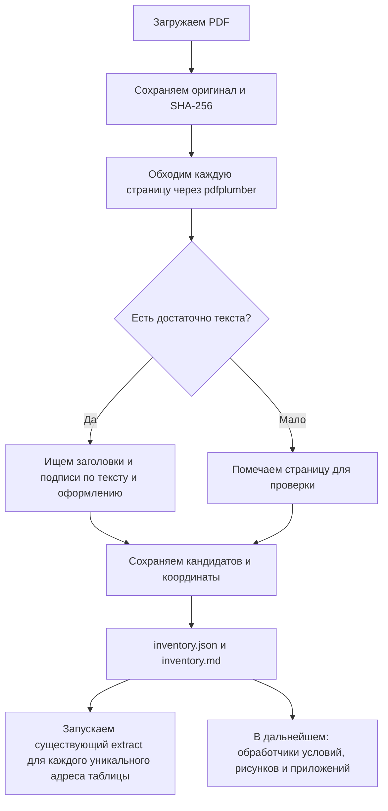

# Карта статьи: первый этап обработки

Карта отвечает на вопрос «что и где находится в PDF». Она помогает выбрать следующую таблицу для разбора и увидеть страницы, которым нужна дополнительная обработка. Значения экспериментов и смысловые связи на этом этапе ещё не извлекаются.

## Карта в вебе

1. Загрузите локальный PDF до 64 МБ. Так же загружаются файлы из `test/`. У каждой загрузки свой адрес карты.
2. Просмотрите карту. Можно показать только таблицы, рисунки, разделы или страницы для проверки. Клик по найденной строке подсвечивает заголовок или подпись справа. Страницы можно листать, а просмотр разворачивать.
3. Нажмите «Запустить прогон статьи». Отдельный исполнитель разберёт каждый уникальный адрес таблицы из карты. В карточке видны состояния этапов, причины исключения кандидатов и предупреждения карты. [Запуск сервера и исполнителя](../web/README.md#разобрать-статью-через-rabbitmq)
4. Выберите готовый этап и нажмите на значение, чтобы увидеть исходную ячейку. Кнопка «К карте статьи» вернёт к подписи таблицы. Кнопки у отдельных таблиц позволяют также запускать и открывать сохранённый разбор одной таблицы.

Карта готова до запуска извлечения. Готовые этапы можно открывать, пока исполнитель обрабатывает остальные таблицы. Если блок пропущен картой, его можно посмотреть через навигацию по PDF. Для поиска метрики в разобранной таблице используются фильтры результатов.

## Запуск

Из корня репозитория, Python 3.12:

```bash
python -m pip install pdfplumber==0.11.10
python -m rag_mvp inspect 'docs/context/RAG_ВИНИТИ_участникам_2026-11-20/dev/D001.pdf' \
  --out /tmp/article-map-d001
```

Можно передать другой локальный PDF. Каталог выхода должен быть новым: существующие результаты команда не перезаписывает. Для одной карты Docling, GPU, API-ключи и загрузка весов не нужны.

На выходе:

- `source.pdf` — копия входа, к которой относится карта.
- `inventory.md` — читаемый список найденных мест и страниц для проверки.
- `inventory.json` — данные для следующих обработчиков.

## Что происходит



В JSON есть версия схемы, хеш PDF, версия движка и параметры группировки текста. Для каждой страницы сохраняются размер, поворот, извлечённый текст, количество его непробельных символов, области растровых изображений и число векторных объектов. Текст собирается из слов с координатами. Читатель ищет зазор между колонками, группирует строки в блоки и выдаёт их в порядке чтения. Те же строки используются для поиска заголовков и подписей в карте. Изображение в PDF может быть логотипом или целой сканированной страницей.

Кандидат содержит `kind` (`section`, `table`, `figure`), страницу, подпись или заголовок, метку, `box` и `status: candidate`. У разделов дополнительно есть предполагаемая роль: основной текст, аннотация, библиография или приложение. Буквенные разделы отмечаются как `possible_appendix`, без утверждения их смысла. Границы разделов и принадлежность каждого абзаца к разделу пока не построены.

Страница нумеруется с 1 по порядку PDF, независимо от печатной нумерации. `box` — `[left, top, right, bottom]` в долях страницы от верхнего левого угла. **Это область подписи или заголовка**, не самой таблицы или рисунка. Идентификатор кандидата связывает его со страницей внутри карты; после изменения алгоритма идентификаторы могут поменяться.

## Как продолжить извлечение

Для D001 карта находит Table 1 на странице 6. С установленными зависимостями текущего MVP:

```bash
python -m rag_mvp extract /tmp/article-map-d001/source.pdf \
  --page 6 --table 1 --out /tmp/article-table-d001
```

Для подписи `Table` с целочисленным номером карта сохраняет `extract_arguments`. Для разбора нужен положительный номер в форме `Table 1` и адрес в пределах PDF. Прогон фиксирует состав найденных кандидатов, уникальные адреса и предупреждения карты. Подписи вроде `Table A.1` и `Таблица 1` и повторные подписи одного адреса учитываются как пропуски с объяснением.

## Ограничения первой версии

Карта ищет распространённые подписи вроде `Table 1:`, `Таблица 1 — …` и `Figure 2.`. Метка таблицы на отдельной строке, например `Table 2`, тоже получает рамку. Ссылка внутри обычного абзаца сама по себе не создаёт подпись. Заголовки определяются по нумерации, известным словам и оформлению шрифта. Сложная вёрстка может склеить соседние строки. У многострочной подписи карта выделяет строку с меткой.

Карта ищет структурные элементы. Полнотекстового поиска по всем абзацам в её интерфейсе пока нет. Отдельный поиск контекста таблицы работает в CLI. Он использует сохранённые фрагменты и проверяемые текстовые ссылки, а для результата отдельно сообщает, найдена ли подпись и удалось ли связать с ней описание условий. Свежие координаты появятся после повторной загрузки PDF или нового запуска `inspect`.

`text_available` означает только наличие хотя бы 80 непробельных символов. Это не оценка правильности чтения. `needs_review` означает мало текста: возможны скан, рисунок, пустая страница или проблема текстового слоя. Даже если предупреждений нет, полнота обнаружения не доказана. Нужна сверка с PDF, прежде чем заявлять охват всей статьи.

OCR, считывание графиков, извлечение темы и автоматическая интерпретация приложений здесь не выполняются.

[Проверка карты на двух PDF из test](research/article-map-smoke.md) · [pdfplumber для таблиц](research/pdfplumber-tables.md) · [Общий план](../.scratch/article-processing/spec.md)
