# Как будет выглядеть демо ВИНИТИ · RAG

Рабочее демо открывается командой `./rag demo` из корня репозитория. [Запуск и доступные сценарии](../web/README.md)

Статический макет на данных из `dev_gold` и фрагментах PDF участников. Числа, идентификаторы и страницы взяты из архива. Схемы показывают проектируемый процесс. Графики построены по эталону, поэтому их нельзя использовать как оценку качества нашего извлечения.

## Черновые расшифровки RAG

- **Rage Against the Garbage** — девиз демо.
- **Rip Apart, Glean** — подпись к схеме пайплайна.

## Загрузка новой статьи

Основной вход — кнопка «Загрузить PDF». Пользователь видит этапы обработки, затем открывает карточку и результаты новой статьи в общей библиотеке. Макет ниже показывает состояние после обработки. Статьи из архива служат примерами результата. [Как устроен продукт](project.md)

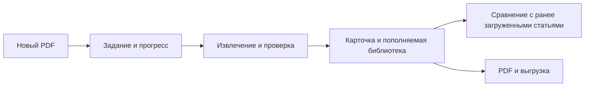

## Что увидит пользователь

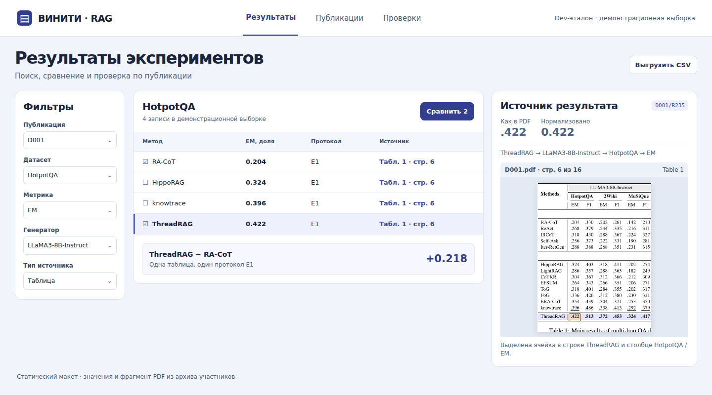

1. В **Результатах** выбираем `D001 → HotpotQA → EM → LLaMA3-8B-Instruct`.
2. Отмечаем **RA-CoT** и **ThreadRAG**. Обе записи относятся к протоколу `E1` одной статьи. Интерфейс показывает абсолютную разницу **+0.218 EM**, то есть **+21.8 процентного пункта** на шкале 0–100.
3. Кликаем по **0.422**. Справа открывается стр. 6 PDF с выделенной ячейкой `.422`. Рядом видны значение после нормализации, путь по заголовкам и ID записи `D001/R235`.
4. Нажимаем **«Выгрузить CSV»** и получаем пакет из той же версии данных. На вкладке **Проверки** можно увидеть замечания и открыть их источники.

## Путь от статьи до результата

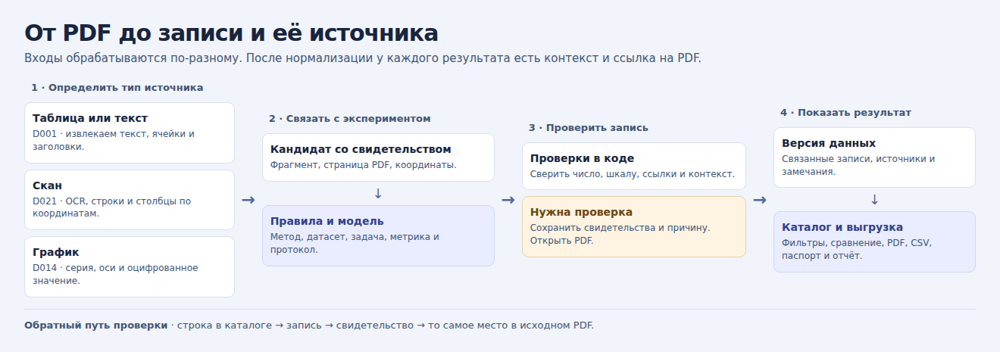

Один опубликованный набор питает три выхода. **Каталог** показывает строки и их источники. **Сравнение** проверяет совместимость условий. **Выгрузка** формирует `publications.csv`, `configurations.csv`, `datasets.csv`, `tasks.csv`, `experiments.csv`, `results.csv` и `issues.csv`. К комплекту идут паспорт полей и правил и отчёт проверки. Из любой строки путь идёт обратно к странице или области оригинального PDF.

## Вариант 1. Обычный PDF с многоуровневой таблицей

**Источник** — `D001.pdf`, стр. 6, Table 1. В одной строке таблицы есть 18 результатов по разным генераторам, датасетам и метрикам.

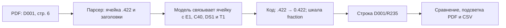

| Этап | Что происходит на этом примере |
| --- | --- |
| Парсер | Извлекает `.422` и координаты ячейки, сохраняет строку `ThreadRAG` и вложенный заголовок `LLaMA3-8B-Instruct → HotpotQA → EM`. |
| Модель | Получает таблицу и §4.1. Предлагает связи с конфигурацией `C40`, набором `DS1`, задачей multi-hop QA `T1` и протоколом `E1`. Ссылается на переданные блоки. |
| Код | Берёт число из ячейки. Нормализует запись с ведущим нулём, проверяет шкалу и ссылки. Исходное поле единицы остаётся пустым, как в таблице. |
| Интерфейс | Показывает значение, условия и PDF. При выборе RA-CoT из той же таблицы показывает разницу. При выборе соседней колонки F1 объясняет, что метрики разные, и оставляет только просмотр рядом. |

Ниже сокращённый срез реальных строк `results.csv`. Полная выгрузка также содержит вариант метрики, происхождение, цитату, статус и другие поля шаблона.

```csv
publication_id,result_id,experiment_id,config_id,dataset_id,task_id,metric_name,raw_value,normalized_value,normalized_unit,source_page,source_table
D001,R001,E1,C01,DS1,T1,EM,.204,0.204,fraction,6,Table 1
D001,R235,E1,C40,DS1,T1,EM,.422,0.422,fraction,6,Table 1
```

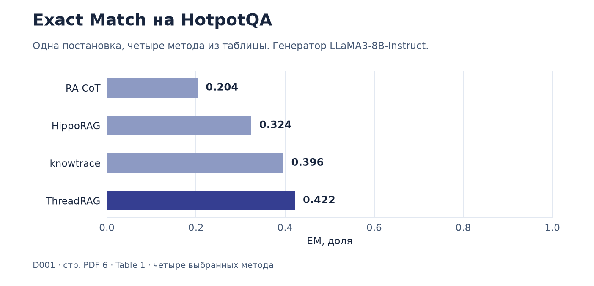

Четыре выбранные строки `R001`, `R091`, `R217`, `R235` из `D001`. [Увеличить исходную таблицу с выделенной ячейкой](assets/demo/d001-table.png)

## Вариант 2. Таблица на скане

**Источник** — `D021.pdf`, стр. 11, Table 1. Текстовый слой пуст. Во второй строке PDF напечатано `SQuAD`, а оценочный набор для groundedness в эталоне обозначен `SQuAD-G`.

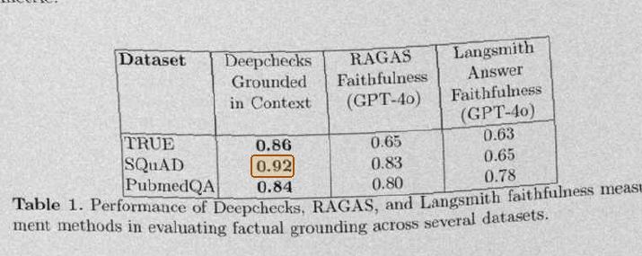

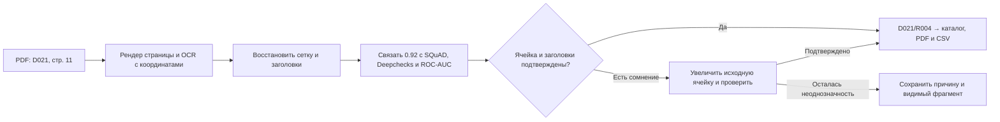

Из OCR берём напечатанное `0.92`. Из подписи и раздела §4.1 берём задачу **оценки groundedness** и метрику **ROC-AUC**. Привязку `SQuAD → SQuAD-G` объясняет описание набора в эталоне. В панели источника показываем обе формы и роль модели-оценщика.

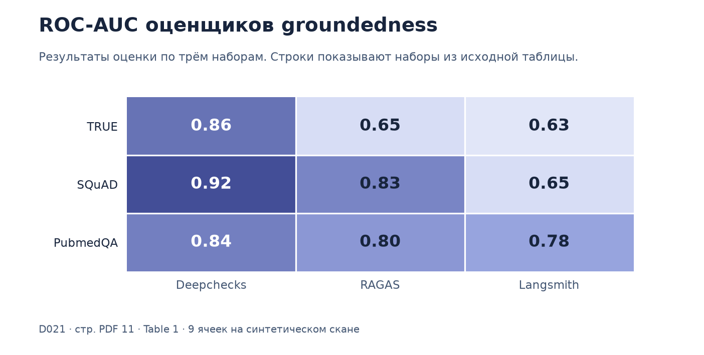

Матрица использует `D021/R001–R009`. Сравнение работает в пределах одной строки датасета. Для демонстрации числа сверены визуально со сканом, качество OCR этим примером не измерялось.

## Вариант 3. Число есть только на графике

**Источник** — `D014.pdf`, стр. 13, Figure 7. Гистограмма распределения Answer F1 для GPT-4o-mini, которому подают по одному предложению-кандидату. В исходнике две серии. В демонстрации выбрана серия HotpotQA.

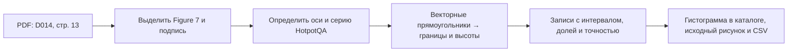

| Интервал Answer F1 | Как записано в эталоне | Что увидит пользователь |
| --- | ---: | --- |
| `[0.00, 0.04)` | `~0.7074` | Около 70.74% ответов · `R28553` |
| `[0.96, 1.00]` | `~0.2079` | Около 20.79% ответов · `R28577` |

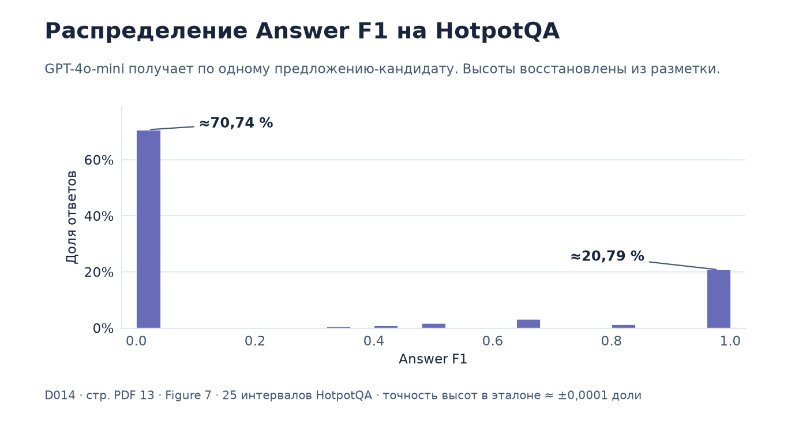

Гистограмма построена по `D014/R28553–R28577`. Высоты и границы взяты из записей, которые организаторы оцифровали из векторных элементов PDF. В эталоне указана точность высот около **±0.0001 доли**. Подпись объясняет эксперимент, а источник чисел проверяется по геометрии графика. [Исходный Figure 7](assets/demo/d014-figure.png)

## Вариант 4. Источники расходятся

**Источник** — `D002`, Table II, стр. 8. В подписи таблицы указано **156** вопросов General, а в основном тексте на стр. 2 и 8 — **150**. Так конфликт описан в эталонном замечании `D002/I01`.

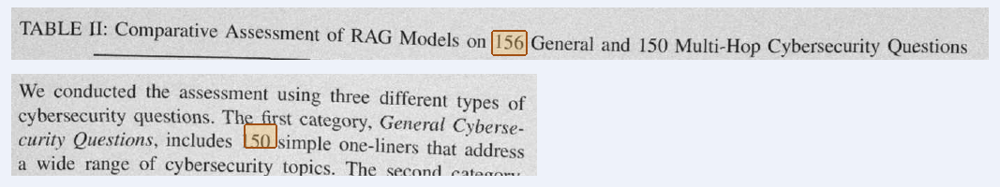

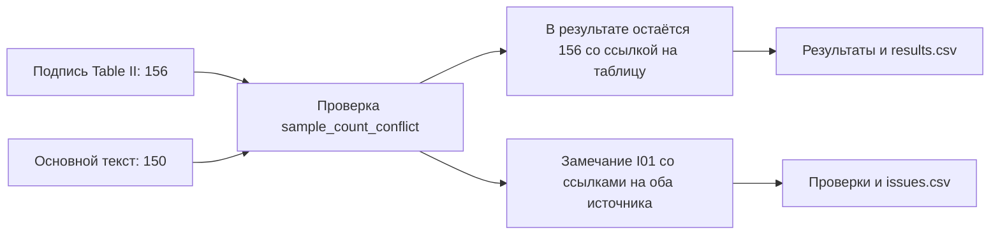

В карточке пишем **«Размер выборки расходится. Таблица — 156, текст — 150»**. Пользователь может открыть оба места. Результат остаётся в каталоге, а сравнение, которому нужен подтверждённый размер выборки, показывает ограничение.

## Как разбираем PDF

| Способ | Как работает | Где применить |
| --- | --- | --- |
| **Парсер и правила** | Сетка, заголовки и числа извлекаются по координатам. Связи задаются правилами по подписи и заголовкам. | Основной путь. Первый контрольный прогон на `D001`. |
| **LLM для спорных связей** | Модель получает проблемную ячейку и связанные фрагменты статьи, затем предлагает связь со ссылкой на основание. | Отдельный эксперимент, если на отложенных статьях видим повторяющиеся ошибки привязки. |
| **OCR и графики** | OCR читает проблемные области скана. Для векторных рисунков величины вычисляются по осям. | Для сканов и рисунков. Случаи, где точного значения получить не удалось, остаются в списке проверки. |

Для защиты достаточно пройти основной путь на `D001`: от выбора строки до подсветки ячейки и выгрузки. Следом показать скан `D021`, происхождение приближённых значений `D014` и замечание `D002/I01`. Так зритель увидит и удачное извлечение, и поведение системы при неопределённости.

[План реализации](plan.md) · [Архив участников с PDF, CSV и аудитом](context/viniti.md)
