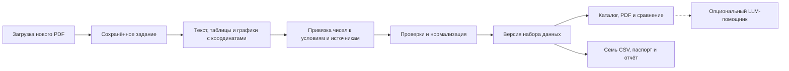

# ВИНИТИ. План реализации RAG-трека

Обновлено 20 ноября 2026 года. Основной пользовательский вход — загрузка новых PDF. [Описание для команды](project.md).

## Что сдаём

**Основной трек — загрузка новых публикаций о RAG и пополняемая база их экспериментов.** Пользователь может найти результат, увидеть настройки и протокол, проверить число в исходном PDF и понять, с чем его корректно сравнивать. К сдаче готовим данные, паспорт полей и правил, интерфейс и отчёт о замечаниях. Для экспорта берём семь CSV из рекомендуемого шаблона участников.

**Солнечные элементы — дополнительный трек.** Подключаем после полного прогона по 90 тестовым PDF RAG, проверки экспорта и репетиции демо. Для второго трека отдельно понадобятся корпус и проверочные примеры. В первой версии общими делаем только чтение PDF, координаты источников, сохранение запусков и просмотр страницы. Схемы результатов и предметные правила пишем для каждой области отдельно.

Порядок приоритетов:

1. Число привязано к правильной конфигурации, датасету, задаче, метрике, протоколу и странице. Неизвестные параметры остаются пустыми. Спорные значения сохраняются с причиной.
2. Корпус обработан воспроизводимо. Видны покрытие, пропуски, замечания и страницы, требующие проверки. Экспорт соответствует шаблону.
3. Каталог и просмотр источника дают законченный сценарий. Сравнение показывает условия и объясняет ограничения.
4. Поиск обычным языком, расширенная оцифровка редких типов графиков и солнечный трек добавляются по оставшемуся времени. Базовый путь для графиков включаем в основной трек.

## Как выглядит продукт

Начальный сценарий — «Загрузить PDF» с сохранённым заданием и прогрессом. Завершённая обработка открывает карточку статьи. В библиотеке один рабочий экран. Слева фильтры, в центре таблица, справа панель с контекстом результата и исходной страницей. На узком экране источник открывается отдельной панелью. В верхней навигации три раздела — **Результаты**, **Публикации**, **Проверки**.

- **Результаты.** Поиск по статьям, методам, датасетам и метрикам. Фильтры по датасету и split, задаче, метрике, модели, типу источника и статусу. В строке видны название метода, датасет, метрика со значением и единицей, ссылка на источник и отметка о замечаниях.
- **Источник.** Клик по строке открывает страницу PDF с подсветкой ячейки, фрагмента текста или области графика. Рядом показываем путь по заголовкам таблицы, исходное и нормализованное значения, протокол и конфигурацию. Если есть только якорь страницы или области, интерфейс показывает доступную точность привязки. Масштаб, поворот и положение подсветки рассчитываются вместе с PDF-страницей. [Примеры PDF.js](https://mozilla.github.io/pdf.js/examples/)
- **Сравнение.** Две или несколько выбранных строк. Сервер проверяет совпадение задачи, датасета и split, варианта метрики и `@k`, шкалы, агрегации и протокола. Если условия различаются или данных недостаточно, строки можно посмотреть рядом, а разница и ранжирование не рассчитываются. Для сопоставимых записей можно показать абсолютную разницу в общей шкале.
- **Публикации и проверки.** Прогресс по документам, какие страницы обработаны OCR, где остались пропуски. У замечания видны правило, связанные записи, страница и фрагмент. CSV и отчёт скачиваются из той же версии данных, что открыта в интерфейсе.

**Сценарий демо.** Фильтруем `D001` по HotpotQA, EM и LLaMA3-8B-Instruct. В Table 1 на стр. 6 есть `RA-CoT .204` и `ThreadRAG .422`. Показываем обе ячейки и условия сравнения. Затем открываем `D021`, стр. 11, где девять результатов ROC-AUC находятся в таблице на скане, и показываем, как оператор проверяет конкретную ячейку по изображению. Для графиков подойдёт один проверенный фрагмент `D014` с указанной точностью.

## Как должно работать

- **Python-обработчик для новых загрузок и CLI для пакетного импорта.** На обычных страницах сохраняем текст, многослойные заголовки и ячейки, отдельно подписи и графику. Стартовые кандидаты — Docling для структуры и Poppler как контроль текста. Пилот и предлагаемые пороги качества описаны в [исследовании извлечения](research/viniti-pdf-extraction.md). На сканах сначала проверяем OCR внутри Docling. Другой OCR-движок оцениваем под конкретный тип ошибки на тех же страницах. Сначала оцениваем точность числовых ячеек вместе с заголовками, потом время обработки. Для векторных графиков проверяем извлечение координат через PyMuPDF и калибруем по осям. Растровые подписи читаем OCR. Если значение с известным местом достоверно не считывается, помечаем фрагмент для проверки с указанием причины. [Docling](https://docling-project.github.io/docling/concepts/docling_document/) · [PyMuPDF](https://pymupdf.readthedocs.io/en/latest/recipes-drawing-and-graphics.html)
- **Общий формат свидетельств.** Для блока и ячейки храним `evidence_id`, ID и хеш PDF, страницу с 1, тип источника, исходный текст, координаты и сведения о движке. Координаты приводим к одной системе до передачи в UI. Для графика сохраняем подпись, оси, серию, способ оцифровки и допустимую точность. В сведениях о прогоне сохраняем версии и настройки парсера, OCR, распознавания структуры и правил. Сохраняем результаты этапов по статье, чтобы повторять обработку отдельных документов.
- **Нормализация и проверки в коде.** Числа из ячеек и OCR берём из привязанного фрагмента, значения точек рассчитываем по калибровке. Исходную строку храним рядом с нормализованной. Доля, процент и процентный пункт различаются по явным признакам шкалы. Отдельно проверяем ссылки на сущности, допустимые диапазоны, `top_k` поиска и `k` метрики. Разные протоколы и расходящиеся числа сохраняются как отдельные записи. Повтор одного результата на другой странице связывается через `duplicate_of` при подтверждённой идентичности контекста.
- **Хранилище и API для релизного веба.** Hono принимает новые PDF, сохраняет файлы и задания. Последовательный Python-обработчик сохраняет промежуточные результаты и опубликованные версии в SQLite. API читает только опубликованные результаты, фильтрует и сортирует на сервере. Экспорт строится из выбранной версии. React + Vite показывает загрузку, прогресс, карточки, результаты и PDF через PDF.js. Повтор файла определяется по хешу. Новый запуск сохраняется отдельно, прежние результаты доступны во время обработки. CLI загружает корпус соревнования через тот же прикладной сценарий. Для полнотекста проверяем SQLite FTS5. [Node SQLite](https://nodejs.org/api/sqlite.html)

## Роль модели

**Основной путь MVP и релиза работает без LLM.** Обработчик читает PDF, связывает числа с условиями, нормализует и проверяет записи. Приложение определяет сопоставимость и считает разницу. OCR и специализированные модели распознавания структуры таблиц можно использовать для чтения PDF. Если связь остаётся неоднозначной, сохраняем фрагмент и причину для проверки.

**Помощник работает поверх библиотеки.** Читающие инструменты `search_results`, `get_result` и `compare_results` могут передать ему записи, условия, расчёт и ссылки. Он объясняет вывод и его ограничения. Веб-сценарий и выгрузка работают при выключенном помощнике.

**Покрытие проверяем на отложенных статьях.** После MVP фиксируем правила и отдельно считаем пропуски, неверные числа и неверные связи. Ошибки OCR и структуры направляют доработку чтения PDF. Если числа читаются правильно, а условия систематически теряются между ячейкой и текстом, отдельно проверяем LLM на тех же примерах. Она может предложить связь со ссылкой на переданный фрагмент. Измеряем прибавку полностью правильных записей и новые ошибки до решения, включать ли такой режим.

## Что взять из abstract-s-abstraction

Для первого веб-среза принято самостоятельное приложение React + Vite, Hono и tRPC на обычных зависимостях, без Living UI и внутренних пакетов Abstraction. Из монорепозитория берём кодовые референсы. Ближайший пример — `projects/cool-code` в `abstraction-s-abstract`, просмотренный на базе коммита `0bd0b0a7`. [Принятые решения веба](../.scratch/web-shell/spec.md).

| Что уже есть | Что делаем в проекте |
| --- | --- |
| React/Vite и типизированный tRPC-клиент в `projects/cool-code/apps/web` | Взять способ подключения API, QueryClient, query/mutation и обновления данных. Таблицу, фильтры и панель PDF собрать на обычных компонентах. Living UI-обёртки из примера не переносить. |
| Hono/tRPC и `createApp(runs)` в `projects/cool-code/apps/api/src/app.ts` | Собрать API с переданной зависимостью обработки. Сначала подключить серверный мок; Python добавить через ту же прикладную границу. |
| CRM-адаптер локальной модели через `createOpenAICompatible` | При подключении помощника переиспользовать подход к настройкам провайдера, таймаутам и отмене. Адаптер модели — `abstract-s-abstraction/projects/scavengers-crm/services/core-api/src/assistant/model.ts:1` |
| `@abstraction/assistant-server`, `@abstraction/assistant-react`, `@abstraction/tool-kit` | При добавлении чата взять цикл AI SDK, клиентскую панель и типизированные читающие tools. Серверный `createAssistant` стримит сообщения и подходит для чата. Сервер — `abstract-s-abstraction/packages/backend/assistant/src/index.ts:39` · Панель — `abstract-s-abstraction/packages/frontend/react/assistant/README.md` · Инструменты — `abstract-s-abstraction/packages/shared/tool-kit/src/index.ts:29` |
| `@abstraction/api-kit` и Backend Lab | Использовать как референс обработки ошибок, ID запроса и проверки входных/выходных данных. В первом вебе оставить небольшой локальный код под свой API. API-kit — `abstraction-s-abstract/packages/backend/api-kit/README.md` · Lab — `abstraction-s-abstract/labs/backend/src/app.ts` |

`jobs` и `charts` в монорепо пока описаны в README. Для пакетной обработки хватит CLI с сохранением промежуточных результатов. В изученных компонентах нет готового конвейера для PDF, OCR и происхождения RAG-метрик. Эти части, PDF-инспектор и экспорт будут кодом кейса. Jobs — `abstract-s-abstraction/packages/backend/jobs/README.md` · Charts — `abstract-s-abstraction/packages/frontend/react/charts/README.md`

**Как использовать референсы.** Сохраняем обычные зависимости и самостоятельную установку RAG. Заимствуем способ подключения транспорта и явные границы, а не весь каркас приложения. Для веба выбраны shadcn/ui + Tailwind, TanStack Table, React Router и TanStack Query. Строки про помощника выше — референсы для возможного последующего этапа; подключение этих пакетов сейчас не принято. Исходный монорепозиторий использовался только для чтения.

## Очерёдность работы

**MVP.** CLI принимает PDF и позволяет указать страницу и таблицу. Для D001, стр. 6, Table 1 извлекаем все 18 результатов строки ThreadRAG. Принимаем по совпадению значения, генератора, датасета, метрики, эксперимента и места в PDF. `dev_gold` используем только для сверки.

CLI сохраняет результат прогона и выгружает один плоский CSV. В каждой строке значение, метод, генератор, датасет, метрика, эксперимент, страница и таблица. Минимальный веб-экран читает сохранённый прогон, показывает те же записи с одним фильтром и открывает нужную страницу того же локального PDF с указанием таблицы. Если есть надёжные координаты, подсвечиваем ячейку.

**Первый прогон.** Сохраняем структурированный JSON Docling для D001, стр. 6, Table 1. Сверяем исходное число и путь по шапке от генератора через датасет до метрики для каждой из 18 ячеек ThreadRAG с `R235–R252` из `dev_gold`. Отдельно проверяем, доступны ли точные координаты ячейки. Для MVP подходит переход на страницу с указанием таблицы и пути по шапке. Если Docling теряет сетку или уровни шапки, пробуем геометрический разбор `pdfplumber` на той же странице и сверяем те же связи. По результату уточняем вход [предметного модуля](system.md#предметный-модуль-mvp). [Подходы к извлечению](research/viniti-pdf-extraction.md#подходы-к-извлечению)

**Релиз.** Пользователь загружает новый PDF через веб без ручного выбора страницы или таблицы, видит статус обработки, находит результаты через поиск и фильтры, открывает источники и замечания, сравнивает сопоставимые записи и скачивает выгрузку. Веб-загрузка запускает тот же обработчик, который проверяем через CLI в MVP. Чат и объяснение через MCP проверяем отдельным экспериментом.

Блоки ниже идут по зависимостям. Дедлайн, состав команды, доступный GPU и модельный бюджет пока неизвестны. Если есть несколько исполнителей, после согласования формата свидетельств UI можно собирать параллельно на маленькой демонстрационной выборке. Такую выборку помечаем как эталонную и держим отдельно от предсказаний.

| Блок | Действия | Как принимаем |
| --- | --- | --- |
| **1. MVP** | Извлечь результаты из указанной таблицы через CLI, выгрузить один плоский CSV и открыть сохранённый прогон на минимальном веб-экране. | Все 18 результатов ThreadRAG совпадают с эталоном по значениям и связям. CSV и веб показывают одни записи. Фильтр работает, клик открывает нужную страницу того же PDF и указывает таблицу. |
| **2. Сравнение извлечения** | `D001` для вложенных заголовков, `D013` для OCR и mean/SD, `D021` для OCR, `D014` для калибровки векторного графика. Сравнивать варианты чтения и правила на одинаковых входах. Проверить перенос на отложенных dev-статьях. | Есть таблица ошибок по ячейкам, полям и источникам, время на страницу и решение, где какой движок используем. |
| **3. Правила и веб** | Подключить веб-загрузку к обработчику, развить каталог и просмотр источников. Масштабировать извлечение текста, таблиц, подписанных и векторных графиков. Добавить нормализацию, сравнение и список спорных записей. | Новый PDF проходит от веб-загрузки до карточки без ручного выбора страницы. Видны статус, результаты поиска и фильтрации, источники, замечания и сравнение. Выгрузка скачивается из веба. |
| **4. Полный пакет** | Прогнать dev, разобрать провалы, зафиксировать версии, затем обработать 90 test PDF. Прогнать чекер участников и отдельно проверить визуальные свидетельства, на которых он выдаёт предупреждения. | Все 90 документов учтены в `publications.csv`, ссылки и форматы проходят техническую проверку, нерешённые предупреждения объяснены. Есть воспроизводимый запуск, семь CSV, паспорт, отчёт и сохранённый демо-прогон. |
| **5. Расширения** | Оценить по оставшемуся времени солнечный трек и чат. Для солнечного трека начать с одной статьи и полного пути «прибор → условия → метрика → источник». | Второй трек идёт в демо, когда есть данные, предметная проверка и хотя бы один воспроизводимый сценарий. |

Оценка для dev — precision/recall по совпадению значения **в правильном контексте**, с матчингом сущностей по их полям и странице, поскольку ID генерируем сами. Отдельно смотрим совпадение числа, смысловых связей и источника. Для оцифрованных графиков учитываем допуск из аудита, если он указан. Отчёт показываем по тексту, таблицам, графикам, обычным PDF и сканам, со средним по статьям и отдельным результатом по `D014`. В пакете `D014` даёт 28 649 из 37 616 строк, поэтому один общий счёт легко скрывает ошибки на других статьях. Чекер участников используем для технической приёмки. Веса официальной оценки и пороги качества здесь не предполагаются.

**Что уже проверено локально.** У `D001` Table 1 совпали 252 пары «название метода–исходное число» из `pdftotext -layout`. Привязки к заголовкам этим тестом не проверялись. На `D021`, стр. 11, текстовый слой пуст, таблица видна на изображении. FTS5 работает в доступных версиях Node и Python на пробном запросе. Полный прогон парсеров и работа веб-интерфейса ещё требуют проверки.

## Материалы кейса

- [Бриф ВИНИТИ+ЮФУ](context/ВИНИТИ+ЮФУ.pdf), стр. 7–11.
- [Архив участников](context/viniti.md), в том числе `submission_template/`, `dev_gold/coverage/` и `tools/check_submission.py`.
