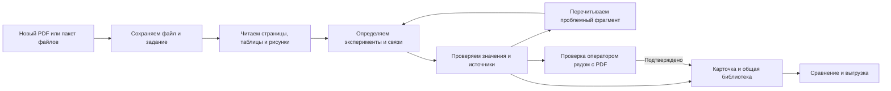

# Как работает продукт ВИНИТИ

Обновлено 20 ноября 2026 года. Основной трек — статьи про RAG. Солнечные элементы добавляем после готовности основного сценария.

## Идея продукта

**Пользователь загружает новую научную статью и получает её структурированную карточку с экспериментами, результатами и ссылками на исходные страницы.** Новые статьи пополняют общую библиотеку. Результаты из нескольких статей можно искать и сравнивать, когда их условия сопоставимы.

Корпус из архива даёт нам материал для разработки и проверки. Dev содержит готовые ответы для проверки качества, test позволяет оценивать работу на других документах. В рабочем продукте каждый новый PDF проходит самостоятельную обработку. Имена D001 и P001 нужны для корпуса соревнования. Загружаемым файлам система назначает свои идентификаторы.

В брифе прямо описаны извлечение из PDF, проверка источников, сопоставление результатов и интерфейс поиска. Загрузка файлов через веб-интерфейс там отдельно не оговорена. Для нашего продукта принимаем её как основной способ добавления документов. Архив можно загрузить пакетно через тот же процесс. [Бриф, стр. 7–11](context/ВИНИТИ+ЮФУ.pdf)

«Любая статья» в первом треке означает новый PDF с исследованием RAG и экспериментальной оценкой. Для статьи по другой теме система объясняет, почему предметные поля RAG к ней неприменимы. Обзор без собственных экспериментов, плохой скан, приложение к статье и файл с паролем требуют своих исходов. При загрузке пользователь должен видеть, что удалось обработать и что требует внимания.

## Путь пользователя

1. **Добавить статью.** Нажать «Загрузить PDF», выбрать один или несколько файлов. Для уже загруженного файла система предлагает открыть существующую карточку. Новая редакция статьи может храниться рядом с прежней.
2. **Дождаться обработки.** У каждого файла видны этап и состояние. Можно продолжать работу с библиотекой. После обновления страницы задания и результаты сохраняются.
3. **Открыть карточку.** Название, авторы, год и DOI при наличии. Краткое описание задачи, изученные методы, датасеты, настройки и таблица результатов. У каждого утверждения о статье есть источник.
4. **Проверить число.** Нажать на значение и увидеть нужную страницу PDF с выделением. Рядом исходная запись, единица, условия измерения и способ извлечения. Для числа с графика видны приближение и точность.
5. **Разобрать замечание.** Открыть спорное значение рядом с той же страницей PDF. Можно сверить его глазами, подтвердить или исправить по источнику. Дополнительная кнопка помощника запрашивает второе мнение по этому фрагменту.
6. **Сравнить результаты.** Выбрать строки из одной или нескольких статей. Система проверяет условия и объясняет допуск к сравнению.
7. **Выгрузить данные.** Скачать выбранные результаты или полный пакет. В выгрузке сохраняются источники и замечания. Данные всей библиотеки и отдельного запуска можно выгружать независимо.

## Что находится в карточке статьи

| Блок | Простое объяснение |
| --- | --- |
| О статье | Кто написал, когда, название, DOI, файл и его версия. |
| Задача | Что исследовали — например, ответы на вопросы с несколькими шагами поиска. |
| Конфигурации | Какие варианты системы сравнили. Модель, поиск, разбиение текста, reranker и прочие явно указанные параметры. |
| Датасеты | На каких данных проверяли, с какой версией и разбиением, если авторы это указали. |
| Эксперименты | Как проводили проверку, какой протокол, размер выборки и условия. |
| Результаты | Одна строка — конкретная метрика для конкретного варианта системы в конкретном эксперименте. |
| Источники и замечания | Страница, таблица или рисунок, фрагмент, найденные противоречия и непроверенные места. |

Если параметр в статье отсутствует, поле остаётся пустым с понятным пояснением. Например, знакомое название модели само по себе не даёт оснований дописывать её версию. Результат чужой работы, процитированный авторами, хранится с указанием происхождения. Когда авторы заново запускают чужой метод, число относится к их эксперименту.

Помощник может составить короткое описание статьи по извлечённым данным. Числа в описании должны ссылаться на конкретные записи. Просмотр исходной страницы доступен рядом с описанием.

## Как связываем данные и где нужен помощник

**Решение команды от 20 ноября 2026 года.** Первые тесты помощника проводим через MCP. Покупку отдельного API-доступа и развёртывание модельного сервера откладываем до результатов тестов. [Пробный запуск](architecture/first-slice.md#пробный-запуск-через-mcp)

**Обычный путь.** Обработчик извлекает числа и условия из текста, таблиц и графиков. Когда число читается и его связь с экспериментом подтверждается заголовками, подписью или текстом статьи, сохраняем результат и фрагменты источника. Например, для `.422` из D001 строка даёт ThreadRAG, а путь по шапке — LLaMA3-8B-Instruct, HotpotQA и EM. Для графика сохраняем серию и шкалу, способ чтения и точность, если значение пришлось оцифровать. [Примеры таблицы и графика](demo.md)

**Повторное чтение.** Если OCR повредил число, сетка сместила ячейку или заголовок потерялся, перечитываем проблемную область подходящей стратегией. Если число читается, а его смысл неясен, ищем условие в шапке, подписи или тексте эксперимента. Когда прогоны расходятся и источника недостаточно для выбора, сохраняем варианты с происхождением и создаём замечание. В текущих пробах стратегии выбираем явно. Автоматическое переключение добавляем после проверки признаков сбоя. [Стратегии и признаки ошибок](research/table-parsing-options.md)

**Проверка оператором.** В карточке замечания видны извлечённая запись, причина сомнения и нужная страница PDF с подсветкой доступной области. Оператор может подтвердить прочитанное, исправить значение или его привязку по источнику либо оставить вопрос открытым. Исходное извлечение и ручное решение сохраняются раздельно. Подтверждённые результаты из разных частей статьи собираются в одну версию данных для каталога, сравнения и выгрузки. При неоднозначной привязке число и источник доступны в замечании до подтверждения. [Привязка к PDF](../.scratch/source-links/spec.md#как-ставим-привязку-к-источнику) · [Правила выгрузки](research/viniti-requirements-gap-analysis.md#согласовано-на-grill-with-docs)

**Дополнительная проверка через MCP.** По кнопке «Проверить с помощником» модель получает выбранную запись, причину замечания и доступные фрагменты статьи. Она предлагает трактовку со ссылкой на источник или объясняет, каких сведений не хватает. Предложение остаётся подсказкой для оператора. Отдельный сценарий «Объяснить сравнение» передаёт помощнику уже рассчитанную разницу, условия и ссылки. Основная обработка, правила проверки, сравнение и выгрузка работают без LLM. Точность подсказок для спорных мест проверяем отдельно. [Роль модели в плане](plan.md#роль-модели) · [Проба объяснения через MCP](architecture/first-slice.md#пробный-запуск-через-mcp)

## Как устроено сравнение

Сравнение между статьями входит в основной сценарий. Одного совпавшего названия датасета недостаточно. Проверяем задачу, версию и split набора, определение метрики, шкалу и протокол. Различия в генераторах или способах поиска могут быть предметом исследования, поэтому интерфейс показывает эти различия рядом с условиями оценки.

| Ситуация | Что показывает система |
| --- | --- |
| Совпали нужные условия | Две строки рядом, их конфигурации, разницу в общей шкале и источники. |
| Условия явно различаются | Различия выделены, значения доступны для просмотра рядом. |
| Часть условий не указана | «Сопоставимость требует проверки» и список недостающих сведений. |
| Одинаково названная метрика имеет разные определения | Исходные определения и объяснение ограничения. |

Пример вывода по D001. На HotpotQA с LLaMA3-8B-Instruct в основном эксперименте ThreadRAG получил EM 0.422, RA-CoT — 0.204. Разница составляет 21.8 процентного пункта и относится к условиям этого эксперимента. Для сравнения с новой статьёй на HotpotQA нужны подтверждённые условия с обеих сторон. [D001 и его таблица](demo.md)

На сдаче показываем работающую библиотеку и передаём связанный датасет, паспорт данных и отчёт о замечаниях. Сравнение методов — один из способов продемонстрировать, как библиотека отвечает на конкретный вопрос по статьям. Бриф задаёт условия сопоставления. Организаторы оценивают результат по эталонной разметке и независимым примерам. [Задание ВИНИТИ, стр. 9](context/ВИНИТИ+ЮФУ.pdf#page=9) · [Состав сдачи, стр. 11](context/ВИНИТИ+ЮФУ.pdf#page=11)

На демонстрации можно загрузить статью, найти два результата, открыть их ячейки и сравнить значения при подтверждённых условиях. Затем показать замечание у спорного значения и скачать выгрузку той же версии данных. [Контрольные примеры](demo.md)

## Какие готовые решения используем

Кандидаты ниже подобраны под конкретные части продукта. Документация подтверждает их возможности. Соответствие нашему корпусу и среде подтверждаем пробным прогоном. До него оценка «100% подходит» была бы недостоверной. Для каждого компонента заранее фиксируем, какое поведение он должен обеспечить.

| Часть продукта | Что берём готовым | Что остаётся написать | Как подтверждаем пригодность |
| --- | --- | --- | --- |
| Чтение PDF | **Docling** как основной кандидат. Он представляет текст, таблицы, картинки и их структуру, сохраняет доступные координаты и происхождение блоков. | Перевод в наши записи, связь с документом и запуском. | Новый файл с вложенными заголовками, скан и смешанный PDF. Сверка чисел, заголовков и страницы. [Docling](https://docling-project.github.io/docling/concepts/docling_document/) |
| OCR | Сначала проверяем OCR, который можно подключить внутри **Docling**. Если он закрывает сценарий, используем одну цепочку обработки. **MinerU** рассматриваем как альтернативу для проблемных документов. | Выбор резервного пути по наблюдаемой ошибке и сохранение результатов. | Точность чисел, знаков и заголовков на сканах. Измеряем время, память и долю ручной проверки. [OCR Docling](https://docling-project.github.io/docling/concepts/OCR/) · [MinerU](https://opendatalab.github.io/MinerU/reference/output_files/) |
| Поиск условий в статье | Готовое разбиение документа Docling по структуре и обычный полнотекстовый поиск SQLite. | Правила выбора контекста, связывания условий с результатом и привязки к фрагменту. | Нужный протокол находится также в приложении или на другой странице. [Разбиение](https://docling-project.github.io/docling/concepts/chunking/) · [SQLite FTS5](https://sqlite.org/fts5.html) |
| Объяснение сравнения | **Qwen через сервер команды** как кандидат для отдельного эксперимента. | Читающий доступ к сравнению и источникам. | Объяснение сохраняет условия сравнения, использует готовые расчёты и ссылается на нужные места в PDF. |
| Просмотр оригинала | **PDF.js** для страниц, масштаба и поворота. | Связь выбранного результата с подсветкой области, переход на нужную страницу. | Подсветка остаётся на ячейке после масштаба и поворота. [PDF.js](https://mozilla.github.io/pdf.js/examples/) |
| Экран библиотеки | **React + Vite**, shadcn/ui + Tailwind, TanStack Table, React Router и TanStack Query; Hono/tRPC для API. | Таблица результатов, фильтры, панель PDF, затем загрузка и состояния обработки. | Первый веб-срез: готовый D001 → результат → фрагмент → вся страница. Самостоятельная сборка без Living UI и внутренних пакетов Abstraction. [Решения веба](../.scratch/web-shell/spec.md) |
| Графики | **PyMuPDF** для чтения векторных элементов, **WebPlotDigitizer** для контрольной ручной оцифровки. | Калибровка осей, определение серий, связь с метрикой и точность результата. | Гистограмма, кривая и точки проверяются отдельно. Сложный рисунок может требовать ручной проверки. [PyMuPDF](https://pymupdf.readthedocs.io/en/latest/recipes-drawing-and-graphics.html) · [WebPlotDigitizer](https://automeris.io/docs/digitize/) |
| Хранение | **SQLite**, файловое хранилище исходных PDF и промежуточных результатов. | Предметные таблицы, задания, версии и публикация результатов. | Повторная загрузка, перезапуск процесса, добавление статьи без потери прежних данных. |

Docling умеет дополнительно классифицировать и описывать изображения. Описание графика полезно для понимания его смысла. Пригодность для точного считывания чисел оцениваем отдельно. У Docling также есть показатели уверенности чтения страницы, которые можно использовать как один из сигналов для проверки. Показатель уверенности парсера сам по себе не доказывает правильность привязки к эксперименту. [Изображения](https://docling-project.github.io/docling/usage/enrichments/) · [Уверенность](https://docling-project.github.io/docling/concepts/confidence_scores/)

Начинаем с одного основного парсера. Резервный движок добавляем под измеренный тип ошибки. Точные версии, требования к GPU и лицензии кода и весов проверяем перед фиксацией сборки.

## Что происходит при загрузке и сбоях

Загрузка создаёт сохранённое задание. Рабочий процесс забирает его и проходит этапы чтения, извлечения, проверки и сохранения результата. Для первой версии достаточно одного последовательного обработчика. Состояние хранится в базе, поэтому перезапуск продолжает незавершённую работу с последнего завершённого этапа. Конкретную очередь выбираем, когда станет понятен требуемый параллелизм.

В интерфейсе используем состояния **«В очереди»**, **«Читаем PDF»**, **«Извлекаем эксперименты»**, **«Проверяем»**, **«Готово»**, **«Готово, есть замечания»**, **«Нужна проверка»**, **«Не удалось обработать»**. Процент показываем только для этапов с известным объёмом, например 8 из 12 страниц.

Повторный файл определяем по хешу содержимого. DOI помогает связать редакции, но не заменяет сравнение файлов. Повторная обработка с обновлённым парсером или правилами сохраняет новый запуск. Пользователь видит, какой запуск опубликован. Ручные подтверждения и исправления хранятся с исходной записью, чтобы повтор обработки не затёр решение оператора.

Если статья обработана частично, сохраняем извлечённое и список непройденных страниц. После сбоя задание можно повторить, а ранее опубликованная библиотека доступна во время обработки.

## Как убедиться, что выбранная сборка подходит

Проверяем весь путь на новых загрузках. Предлагаемая стартовая приёмка:

1. Загрузить PDF, которого ещё нет в библиотеке. Получить карточку и результаты с источниками без ручной настройки под название статьи.
2. Загрузить обычную статью, скан и статью с графиками. Для каждого типа показать извлечённые данные и оставшиеся вопросы.
3. Проверить на dev правильность чисел, связей и страниц. Отчёт по статьям и типам источников нужен отдельно, поскольку D014 занимает большую часть строк эталона.
4. После настройки прогнать отложенные статьи и test тем же кодом. Для документов без эталона вручную проверить выборку. Корректность JSON и успешный экспорт измеряются отдельно от научной корректности.
5. Проверить сравнение внутри статьи и между статьями. Включить случаи несовпадающих и неизвестных условий.
6. Прервать обработку, перезапустить её, повторно загрузить файл. Ранее опубликованные записи должны сохраняться без дублей.
7. Измерить время, использование памяти и долю записей, требующих проверки. Пороговые значения согласуем после первого измерения и уточнения дедлайна и оборудования.

Первый результат этих проверок — список подтверждённых возможностей и ограничений конкретной сборки. Если проблема относится к одному компоненту, заменяем его адаптер и сохраняем общий формат результатов.

## Что меняется в плане

В MVP проверяем извлечение из указанной таблицы через CLI, выгрузку CSV и переход из строки результата к PDF на минимальном веб-экране. К релизу добавляем веб-загрузку и пользовательский путь через библиотеку. Полный пакет соревнования прогоняем через тот же обработчик. [Этапы и приёмка MVP](plan.md#очерёдность-работы)

Демонстрационный корпус в схемах показывает ожидаемый результат. Docling, OCR-резерв и загрузку через UI предстоит проверить полным прогоном.

[Визуальное демо с данными из архива](demo.md) · [Технический план](plan.md)

Точечные переходы из полей результата в PDF описаны в [спецификации ссылок](../.scratch/source-links/spec.md).
